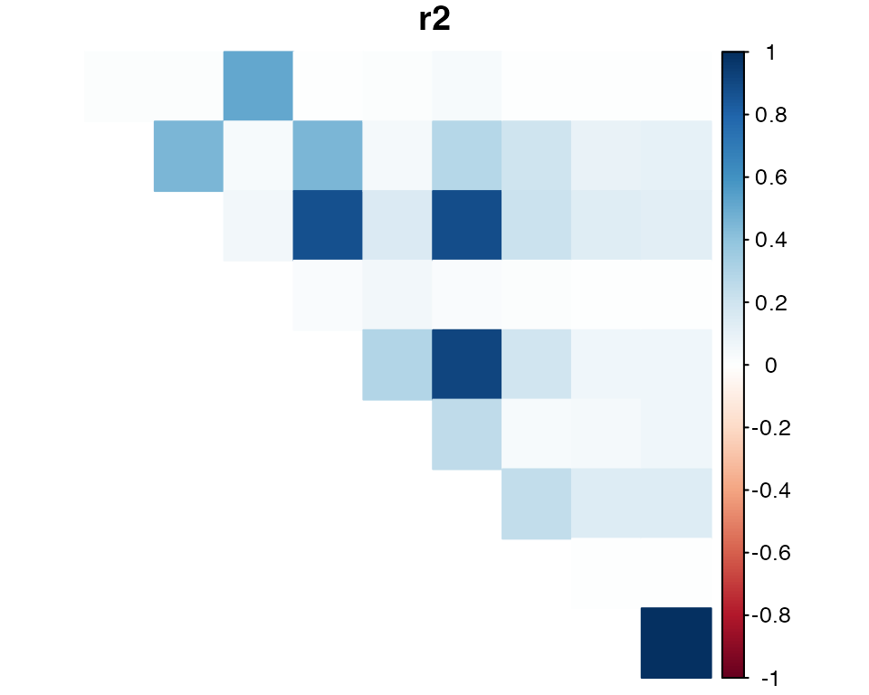

# LD Estimation Pipeline from VCF

## Summary

This vignette covers how to

1.  Load read-count data from a VCF file into R using
    `VariantAnnotation`,
2.  Format these data for genotyping using `updog`,
3.  Format the `updog` output for LD estimation using `ldsep`, and
4.  Estimate LD using `ldsep` on the formatted output.

We will need the following packages:

\
[`library`](https://rdrr.io/r/base/library.html)`(``VariantAnnotation``)`\
[`library`](https://rdrr.io/r/base/library.html)`(`[`updog`](https://dcgerard.github.io/updog/)`)`\
[`library`](https://rdrr.io/r/base/library.html)`(`[`ldsep`](https://dcgerard.github.io/ldsep/)`)`

If you do not have these packages installed, you can install them in R
using:

\
[`install.packages`](https://rdrr.io/r/utils/install.packages.html)`(`[`c`](https://rdrr.io/r/base/c.html)`(``"ldsep"``, ``"updog"``, ``"BiocManager"``)``)`\
`BiocManager``::`[`install`](https://bioconductor.github.io/BiocManager/reference/install.html)`(``"VariantAnnotation"``)`

The following code chunks are only evaluated if all of these packages
are installed. In particular, you need to make sure that your version of
`updog` is at least 2.0.2.

\
[`packageVersion`](https://rdrr.io/r/utils/packageDescription.html)`(``"updog"``)`\
`#> [1] '2.1.7'`

## Analysis

### Extract data from a VCF file using `VariantAnnotation`

The `ldsep` package comes with a VCF file containing a small
(arbitrarily chosen) subset of the data from Uitdewilligen et.
al. (2013). These data consist of a diversity panel of autotetraploid
*Solanum tuberosum* (2n = 4x = 48). The location of this file on your
computer can be found with:

\
`uit_file`` ``<-`` `[`system.file`](https://rdrr.io/r/base/system.file.html)`(``"extdata"``, ``"subuit.vcf"``, `\
`                        package ``=`` ``"ldsep"``,`\
`                        mustWork ``=`` ``TRUE``)`

We will use the excellent `VariantAnnotation` package (Obenchain et.
al., 2014) to load these data into R. You can read more about
`VariantAnnotation` in its vignette:
<https://doi.org/doi:10.18129/B9.bioc.VariantAnnotation>

\
`subuit`` ``<-`` `[`readVcf`](https://rdrr.io/pkg/VariantAnnotation/man/readVcf-methods.html)`(``file ``=`` ``uit_file``)`\
[`class`](https://rdrr.io/r/base/class.html)`(``subuit``)`\
`#> [1] "CollapsedVCF"`\
`#> attr(,"package")`\
`#> [1] "VariantAnnotation"`

A brief description of the genotype fields can be seen with

\
[`geno`](https://rdrr.io/pkg/VariantAnnotation/man/VCF-class.html)`(`[`header`](https://rdrr.io/pkg/VariantAnnotation/man/VCFHeader-class.html)`(``subuit``)``)`\
`#> DataFrame with 8 rows and 3 columns`\
`#>         Number        Type            Description`\
`#>    <character> <character>            <character>`\
`#> GT           1      String               Genotype`\
`#> GQ           1     Integer Genotype Quality, th..`\
`#> GL           G       Float Genotype Likelihood,..`\
`#> DP           1     Integer             Read Depth`\
`#> RA           1     Integer Reference allele obs..`\
`#> AA           1     Integer Alternate allele obs..`\
`#> SR           1     Integer Number of reference ..`\
`#> SA           1     Integer Number of alternate ..`

See the Samtools website for a more detailed description of the format
and the genotype fields in a VCF file:
<http://samtools.github.io/hts-specs/>

To format these data for genotyping in `updog`, we need the total
read-depth, which in this VCF file is the `DP` field, and we need the
read-depth for the reference allele, which in this VCF file is the `RA`
field. You should read the [VCF
documentation](http://samtools.github.io/hts-specs/) (and the
documentation of the software that created the VCF) very carefully,
because you might need to work with other genotype fields to obtain
read-counts. For example, in many VCF files you need to work with the
`AD` field that contains the read-depth for each allele.

\
`sizemat`` ``<-`` `[`geno`](https://rdrr.io/pkg/VariantAnnotation/man/VCF-class.html)`(``subuit``)``$``DP`\
`refmat`` ``<-`` `[`geno`](https://rdrr.io/pkg/VariantAnnotation/man/VCF-class.html)`(``subuit``)``$``RA`

These are matrices where the rows index the loci and the columns index
the individuals. That is, `sizemat[i, j]` is the total read-count at SNP
`i` for individual `j`, while `refmat[i, j]` is the reference read-count
at SNP `i` for individual `j`.

### Genotype individuals using `updog`

To genotype these individuals, we will use the
[`multidog()`](https://dcgerard.github.io/updog/reference/multidog.html)
function from the `updog` R package (Gerard et. al., 2018; Gerard and
Ferrão, 2020). We could use other genotyping programs, as long as they
return genotype log-likelihoods.

We will use `model = "norm"`.

\
`ploidy`` ``<-`` ``4`\
`mout`` ``<-`` `[`multidog`](https://dcgerard.github.io/updog/reference/multidog.html)`(``refmat ``=`` ``refmat``, `\
`                 sizemat ``=`` ``sizemat``, `\
`                 ploidy ``=`` ``ploidy``, `\
`                 model ``=`` ``"norm"``)`\
`#>     |                                   *.#,%    `\
`#>    |||                                 *******/  `\
`#>  |||||||    (**..#**.                  */   **/  `\
`#> |||||||||    */****************************/*%   `\
`#>    |||    &****..,*.************************/    `\
`#>    |||     (....,,,*,...****%********/(******    `\
`#>    |||                ,,****%////,,,,./.****/    `\
`#>    |||                  /**//         .*///....  `\
`#>    |||                  .*/*/%#         .,/   ., `\
`#>    |||               , **/   #%         .*    .. `\
`#>    |||                               ,,,*        `\
`#> `\
`#> Working on it...done!`

We can plot some of the SNPs in a genotype plot (Gerard et. al., 2018)
to evaluate the accuracy of the genotyping:

\
[`plot`](https://rdrr.io/r/graphics/plot.default.html)`(``mout``, indices ``=`` `[`c`](https://rdrr.io/r/base/c.html)`(``1``, ``14``, ``19``)``)`

We probably want to filter out SNPs that are mostly monoallelic. We can
do that with
[`filter_snp()`](https://dcgerard.github.io/updog/reference/filter_snp.html).

\
`msub`` ``<-`` `[`filter_snp`](https://dcgerard.github.io/updog/reference/filter_snp.html)`(``x ``=`` ``mout``, `[`pmax`](https://rdrr.io/pkg/BiocGenerics/man/Extremes.html)`(``Pr_0``, ``Pr_1``, ``Pr_2``, ``Pr_3``, ``Pr_4``)`` ``<`` ``0.95``)`\
[`nrow`](https://rdrr.io/pkg/BiocGenerics/man/nrow.html)`(``msub``$``snpdf``)`\
`#> [1] 10`

We can obtain the genotype log-likelihoods, in the appropriate format
used in `ldesp`, with
[`format_multidog()`](https://dcgerard.github.io/updog/reference/format_multidog.html).

\
`varnames`` ``<-`` `[`paste0`](https://rdrr.io/r/base/paste.html)`(``"logL_"``, ``0``:``ploidy``)`\
`varnames`\
`#> [1] "logL_0" "logL_1" "logL_2" "logL_3" "logL_4"`\
`larray`` ``<-`` `[`format_multidog`](https://dcgerard.github.io/updog/reference/format_multidog.html)`(``x ``=`` ``msub``, varname ``=`` ``varnames``)`\
[`class`](https://rdrr.io/r/base/class.html)`(``larray``)`\
`#> [1] "array"`\
[`dim`](https://rdrr.io/r/base/dim.html)`(``larray``)`\
`#> [1] 10 84  5`

This is a three-way array of genotype *log*-likelihoods. The first
dimension indexes the SNPs, the second dimension indexes the
individuals, and the third dimension indexes the genotypes. That is,
`larray[i, j, k]` is the genotype log-likelihood at SNP `i` for
individual `j` and dosage `k - 1`.

It is possible to also just use the posterior means for LD estimation
(doing so will result in speed gains but a loss of accuracy). You can
extract the posterior means also using
[`format_multidog()`](https://dcgerard.github.io/updog/reference/format_multidog.html).

\
`pmmat`` ``<-`` `[`format_multidog`](https://dcgerard.github.io/updog/reference/format_multidog.html)`(``x ``=`` ``msub``, varname ``=`` ``"postmean"``)`\
[`class`](https://rdrr.io/r/base/class.html)`(``pmmat``)`\
`#> [1] "matrix" "array"`\
[`dim`](https://rdrr.io/r/base/dim.html)`(``pmmat``)`\
`#> [1] 10 84`

This is a matrix of posterior mean genotypes. That is, `pmmat[i, j]` is
the posterior mean genotype at SNP `i` for individual `j`.

### Extracting Log-likelihoods using `fitPoly`

We will also demonstrate how to use the genotyping program, `fitPoly`
(Voorrips et. al., 2011; Zych et. al., 2019), to obtain genotype
log-likelihoods. None of these code chunks are run by default because I
did not want to include more dependencies that are just used in the
vignette. You can run these code chunks manually. Makes sure you have
the `fitPoly` and `reshape2` packages installed:

\
`# install.packages(c("fitPoly", "reshape2"))`\
[`library`](https://rdrr.io/r/base/library.html)`(``fitPoly``)`\
[`library`](https://rdrr.io/r/base/library.html)`(`[`reshape2`](https://github.com/hadley/reshape)`)`

We will first need to format the VCF data appropriately for use in
`fitPoly`.

\
`ratiodf`` ``<-`` `[`melt`](https://rdrr.io/pkg/reshape2/man/melt.html)`(``data ``=`` ``refmat`` ``/`` ``sizemat``, `\
`                varnames ``=`` `[`c`](https://rdrr.io/r/base/c.html)`(``"MarkerName"``, ``"SampleName"``)``, `\
`                value.name ``=`` ``"ratio"``)`\
`saveMarkerModels``(``ploidy ``=`` ``ploidy``, `\
`                 data ``=`` ``ratiodf``, `\
`                 filePrefix ``=`` ``"uit"``,`\
`                 rdaFiles ``=`` ``TRUE``)`

This has created two files in your working directory:

1.  uit_scores.RData: This contains information for each sample. This
    “RData” file contains a data frame called `scores`.
2.  uit_models.RData: This contains information for each SNP. This
    “RData” file contains a data frame called `modeldata`.

We’ll load these data frames into R now.

\
[`load`](https://rdrr.io/r/base/load.html)`(``"./uit_scores.RData"``)`\
[`load`](https://rdrr.io/r/base/load.html)`(``"./uit_models.RData"``)`

We will again filter out SNPs that are monoallelic:

\
`modeldata`` ``<-`` `[`subset`](https://rdrr.io/pkg/BiocGenerics/man/subset.html)`(``x ``=`` ``modeldata``, subset ``=`` `[`pmax`](https://rdrr.io/pkg/BiocGenerics/man/Extremes.html)`(``P0``, ``P1``, ``P2``, ``P3``, ``P4``)`` ``<`` ``0.95``)`\
`scores`` ``<-`` ``scores``[``scores``$``MarkerName`` `[`%in%`](https://rdrr.io/pkg/BiocGenerics/man/match.html)` ``modeldata``$``MarkerName``, ``]`

`fitPoly` only provides posterior genotype probabilities (in the
`scores` data frame), not genotype likelihoods. But we can divide these
posterior probabilities by the provided prior probabilities (in the
`modeldata` data frame) and use these as genotype likelihoods. They
aren’t quite genotype likelihoods, but they are up to a proportional
constant that does not depend on any parameters, and so would result in
the same MLEs as using the real genotype likelihoods. This does create a
little bit more work for us, formatting-wise, however.

\
`mergedf`` ``<-`` `[`merge`](https://rdrr.io/r/base/merge.html)`(``x ``=`` ``scores``[`[`c`](https://rdrr.io/r/base/c.html)`(``"MarkerName"``, ``"SampleName"``, `[`paste0`](https://rdrr.io/r/base/paste.html)`(``"P"``, ``0``:``ploidy``)``)``]``, `\
`                 y ``=`` ``modeldata``[`[`c`](https://rdrr.io/r/base/c.html)`(``"MarkerName"``, `[`paste0`](https://rdrr.io/r/base/paste.html)`(``"P"``, ``0``:``ploidy``)``)``]``, `\
`                 by ``=`` ``"MarkerName"``, `\
`                 all.x ``=`` ``TRUE``)`\
`for`` ``(``i`` ``in`` ``0``:``ploidy``)`` ``{`\
`  ``current_post`` ``<-`` `[`paste0`](https://rdrr.io/r/base/paste.html)`(``"P"``, ``i``, ``".x"``)`\
`  ``current_prior`` ``<-`` `[`paste0`](https://rdrr.io/r/base/paste.html)`(``"P"``, ``i``, ``".y"``)``  `\
`  ``current_ll`` ``<-`` `[`paste0`](https://rdrr.io/r/base/paste.html)`(``"logL_"``, ``i``)`\
`  ``mergedf``[[``current_ll``]``]`` ``<-`` `[`log`](https://rdrr.io/r/base/Log.html)`(``mergedf``[[``current_post``]``]``)`` ``-`` `[`log`](https://rdrr.io/r/base/Log.html)`(``mergedf``[[``current_prior``]``]``)`\
`}`\
\
`fp_llarray`` ``<-`` `[`acast`](https://rdrr.io/pkg/reshape2/man/cast.html)`(`\
`  `[`melt`](https://rdrr.io/pkg/reshape2/man/melt.html)`(``data ``=`` ``mergedf``[`[`c`](https://rdrr.io/r/base/c.html)`(``"MarkerName"``, ``"SampleName"``, `[`paste0`](https://rdrr.io/r/base/paste.html)`(``"logL_"``, ``0``:``ploidy``)``)``]``,`\
`       id.vars ``=`` `[`c`](https://rdrr.io/r/base/c.html)`(``"MarkerName"``, ``"SampleName"``)``, `\
`       variable.name ``=`` ``"dosage"``, `\
`       value.name ``=`` ``"logl"``)``,`\
`  formula ``=`` ``"MarkerName ~ SampleName ~ dosage"``, `\
`  value.var ``=`` ``"logl"``,`\
`)`

We can now, if we choose, use `fp_llarray` instead of `larray` in what
follows. That is, `fp_llarray[i, j, k]` is the genotype log-likelihood
at SNP `i` for individual `j` and dosage `k - 1`.

Note that for sequencing data, `updog` will generally perform better
than `fitPoly`, as `fitPoly` was designed for microarray data. But for
microarray data, `fitPoly` works really well.

### Estimate LD using `ldsep`

We will now demonstrate how to estimate LD using the `ldsep` package
(Gerard, 2021). To estimate LD using maximum likelihood, directly from
genotype log-likelihoods, we will use
[`mldest()`](https://dcgerard.github.io/ldsep/reference/mldest.md) with
the array of genotype log-likelihoods.

\
`like_ld`` ``<-`` `[`mldest`](https://dcgerard.github.io/ldsep/reference/mldest.md)`(``geno ``=`` ``larray``, K ``=`` ``ploidy``, type ``=`` ``"comp"``)`

We can visualize the LD estimates using
[`plot()`](https://rdrr.io/r/graphics/plot.default.html)

\
[`plot`](https://rdrr.io/r/graphics/plot.default.html)`(``like_ld``)`

The naive LD estimates (using just sample moments) with the posterior
mean can also be found using
[`mldest()`](https://dcgerard.github.io/ldsep/reference/mldest.md):

\
`mom_ld`` ``<-`` `[`mldest`](https://dcgerard.github.io/ldsep/reference/mldest.md)`(``geno ``=`` ``pmmat``, K ``=`` ``ploidy``, type ``=`` ``"comp"``)`

The larger naive LD estimates are noticeably attenuated toward zero (due
to the influence of genotype uncertainty).

\
[`plot`](https://rdrr.io/r/graphics/plot.default.html)`(``mom_ld``)`

It is easier to see this attenuation in a scatterplot. The red, dashed
line is the y=x line and any points above this line are pairs of SNPs
where the LD was estimated to be larger by the MLE method compared to
the naive method. The larger LD values are much more attenuated using
the naive approach.

\
[`par`](https://rdrr.io/r/graphics/par.html)`(``mar ``=`` `[`c`](https://rdrr.io/r/base/c.html)`(``2.4``, ``2.8``, ``0``, ``0``)`` ``+`` ``0.5``, mgp ``=`` `[`c`](https://rdrr.io/r/base/c.html)`(``1.8``, ``0.6``, ``0``)``)`\
[`plot`](https://rdrr.io/r/graphics/plot.default.html)`(``mom_ld``$``r2``, ``like_ld``$``r2``, `\
`     xlab ``=`` `[`expression`](https://rdrr.io/r/base/expression.html)`(`[`paste`](https://rdrr.io/pkg/BiocGenerics/man/paste.html)`(``textstyle``(``Naive``)``, ``~``~`[`hat`](https://rdrr.io/r/stats/influence.measures.html)`(``r``)``^``2``)``)``, `\
`     ylab ``=`` `[`expression`](https://rdrr.io/r/base/expression.html)`(`[`paste`](https://rdrr.io/pkg/BiocGenerics/man/paste.html)`(``textstyle``(``MLE``)``, ``~``~`[`hat`](https://rdrr.io/r/stats/influence.measures.html)`(``r``)``^``2``)``)``, `\
`     pch  ``=`` ``20``)`\
[`abline`](https://rdrr.io/r/graphics/abline.html)`(``0``, ``1``, lty ``=`` ``2``, col ``=`` ``2``)`

Finally, these LD estimates may be obtained in matrix form using
[`format_lddf()`](https://dcgerard.github.io/ldsep/reference/format_lddf.md).

\
`ldmat`` ``<-`` `[`format_lddf`](https://dcgerard.github.io/ldsep/reference/format_lddf.md)`(``obj ``=`` ``like_ld``, element ``=`` ``"r2"``)`\
`ldmat``[``1``:``4``, ``1``:``4``]`\
`#>               PotVar0070390 PotVar0070392 PotVar0070393 PotVar0070394`\
`#> PotVar0070390            NA    0.01381594    0.01330103    0.51747366`\
`#> PotVar0070392            NA            NA    0.45680287    0.03629720`\
`#> PotVar0070393            NA            NA            NA    0.05938523`\
`#> PotVar0070394            NA            NA            NA            NA`

## References

- Gerard, David (2021). “Pairwise Linkage Disequilibrium Estimation for
  Polyploids.” *Molecular Ecology Resources*, *21*(4), 1230–1242.
  [doi:10.1111/1755-0998.13349](https://doi.org/10.1111/1755-0998.13349).

- Gerard D, Ferrão L (2020). “Priors for Genotyping Polyploids.”
  *Bioinformatics*, *36*(6), 1795-1800. ISSN 1367-4803,
  [doi:10.1093/bioinformatics/btz852](https://doi.org/10.1093/bioinformatics/btz852).

- Gerard D, Ferrão L, Garcia A, Stephens M (2018). “Genotyping
  Polyploids from Messy Sequencing Data.” *Genetics*, *210*(3), 789-807.
  ISSN 0016-6731,
  [doi:10.1534/genetics.118.301468](https://doi.org/10.1534/genetics.118.301468).

- Obenchain V, Lawrence M, Carey V, Gogarten S, Shannon P, Morgan M
  (2014). “VariantAnnotation: a Bioconductor package for exploration and
  annotation of genetic variants.” *Bioinformatics*, *30*(14),
  2076-2078.
  [doi:10.1093/bioinformatics/btu168](https://doi.org/10.1093/bioinformatics/btu168).

- Uitdewilligen JGAML, Wolters AA, D’hoop BB, Borm TJA, Visser RGF, and
  van Eck HJ (2013). “A next-generation sequencing method for
  genotyping-by-sequencing of highly heterozygous autotetraploid
  potato.” *PloS one* *8*(5), e62355.
  [doi:10.1371/journal.pone.0062355](https://doi.org/10.1371/journal.pone.0062355)

- Voorrips RE, Gort G, and Vosman B (2011). “Genotype calling in
  tetraploid species from bi-allelic marker data using mixture models.”
  *BMC Bioinformatics*, *12*(1), 172.
  [doi:10.1186/1471-2105-12-172](https://doi.org/10.1186/1471-2105-12-172).

- Zych K, Gort G, Maliepaard CA, Jansen RC, and Voorrips RE (2019).
  “FitTetra 2.0–improved genotype calling for tetraploids with multiple
  population and parental data support.” *BMC bioinformatics*,
  *20*(1), 148.
  [doi:10.1186/s12859-019-2703-y](https://doi.org/10.1186/s12859-019-2703-y).
